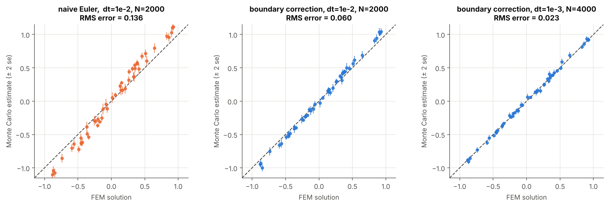
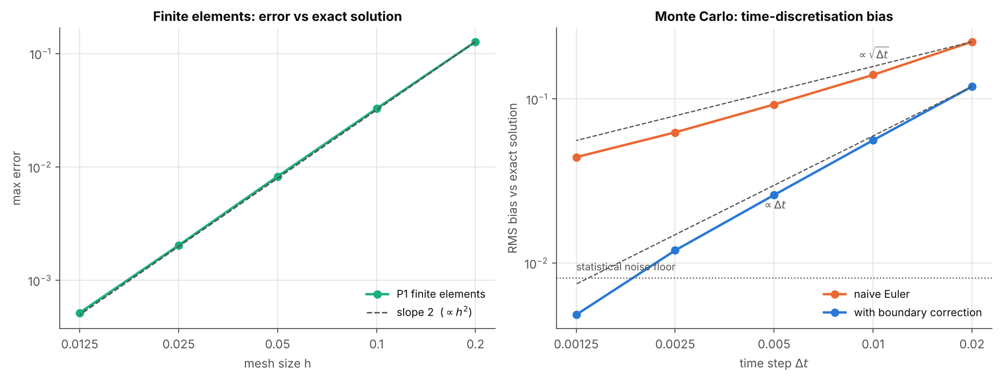
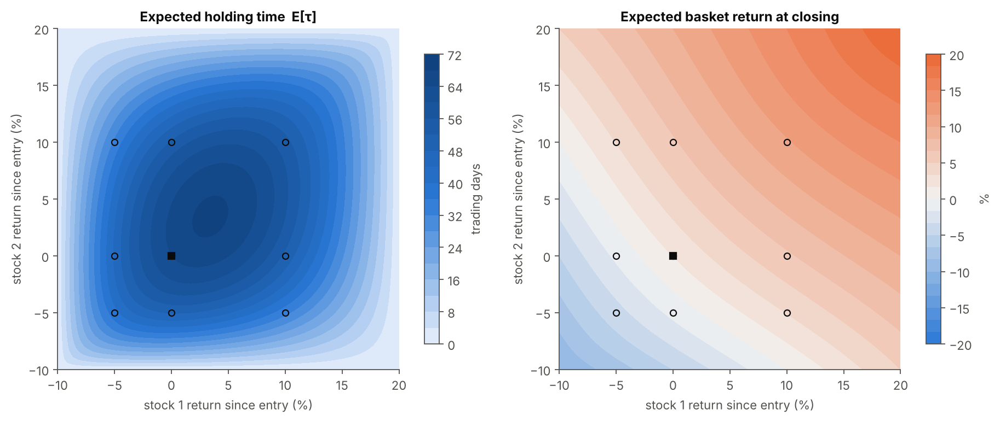

<p align="center">
  
</p>

# 🎲 Boundary Value Problems via Stochastic Differential Equations

**Bridging PDEs and random paths: solving boundary value problems with Itô diffusions, finite elements and Monte Carlo.**


---

## 🔍 About This Project

A boundary value problem is a *deterministic* object; a diffusion process is a *random* one. This project shows that they are two views of the same thing, and uses that fact twice:

1. **To solve PDEs by simulation.** The solution $u(x)$ of an elliptic problem is an *average over random paths* started at $x$ (the Feynman–Kac / Dynkin representation).
2. **To answer questions about random processes without simulating.** "How long until this process leaves a region?" becomes a PDE that finite elements solve for every starting point at once.

The project goes from the theory (Itô's formula → Dynkin's formula → stochastic representation), through a careful numerical validation (finite elements in FreeFEM++ vs Monte Carlo), to a financial application and a high-dimensional example.

### Concepts covered

| Area | Description |
|---|---|
| **Stochastic calculus** | Itô diffusions, generator, Itô and Dynkin formulas, exit times, regular boundary points |
| **Elliptic PDEs** | Dirichlet–Poisson problem for $\mathcal{L}=b\cdot\nabla+\sum a_{ij}\partial_{ij}$, weak formulation |
| **Numerical analysis** | $P_1$ finite elements (FreeFEM++ and Python), Euler–Maruyama, discretisation bias of the exit time, boundary correction |
| **Monte Carlo methods** | Statistical error vs bias, error rates in $\Delta t$ and $N$, the curse of dimensionality |
| **Applications** | Stop-loss / take-profit on correlated assets (quantitative finance) |

---

## 🧠 The Key Idea

For the problem

$$
\mathcal{L}u=-g\ \text{ in } D,\qquad u=\phi\ \text{ on }\partial D,
\qquad \mathcal{L}=\sum_i b_i\partial_i+\sum_{i,j}a_{ij}\partial_{ij},\quad a=\tfrac12\sigma\sigma^T,
$$

let $X$ be the diffusion $dX_t=b(X_t)\,dt+\sigma(X_t)\,dW_t$ and $\tau_D$ its first exit time from $D$. Then

$$
\boxed{\,u(x)=\mathbb{E}^x\big[\phi(X_{\tau_D})\big]+\mathbb{E}^x\!\Big[\int_0^{\tau_D}g(X_s)\,ds\Big]\,}
$$

Why? Itô's formula says that $\mathcal{L}f$ is the *drift* of $f(X_t)$. If $\mathcal{L}u=-g$, then $u(X_t)+\int_0^t g(X_s)\,ds$ has no drift, i.e. it is a martingale, and stopping it at the boundary gives the formula. The whole argument is written out in [notebook 1](01_theory.ipynb).

| PDE | SDE |
|---|---|
| convection $b$ | drift of the particle |
| diffusion $a=\frac12\sigma\sigma^T$ | noise amplitude |
| source $g$ | cost accumulated along the path |
| boundary data $\phi$ | payoff on leaving $D$ |

---

## 📚 Explore the Project

- **[1. Theory](01_theory.ipynb)** — From the PDE to the diffusion: Itô → Dynkin → stochastic representation, with proofs; exit times; regular and irregular boundary points; closed-form 1-D example; where the numerical errors come from.
- **[2. Validation: FEM vs Monte Carlo](02_validation.ipynb)** — The finite-element solution as reference, a diagnosis of the systematic Monte Carlo error, a manufactured exact solution, and measured convergence rates.
- **[3. A real-world application](03_application.ipynb)** — Stop-loss / take-profit on two correlated stocks (expected holding time and expected return of the position), the effect of correlation, and why Monte Carlo wins in high dimension.

---

## 📊 Key Results

The test problem is $\Delta u+b\cdot\nabla u=-g$ on $(-1,1)^2$ with $b=(1,2)$, $g=2\pi^2\sin(\pi x)\sin(\pi y)$, $u=0$ on the boundary.

<p align="center">
  
</p>

| Check | Result |
|---|---|
| Python $P_1$ solver vs FreeFEM++ output (same mesh) | max difference $6\times10^{-7}$ |
| FEM order of convergence (manufactured solution) | $1.99$ (theory: 2) |
| Naive Euler–Maruyama, $\Delta t=10^{-2}$, $N=2000$ | RMS error $0.136$, with $65\%$ of the points more than 3 standard errors from FEM |
| Boundary-corrected, $\Delta t=10^{-3}$, $N=4000$ | RMS error $0.023$ (mean standard error $0.017$); no point beyond 3 standard errors |
| Bias order in $\Delta t$ | naive $\approx0.6$ (theory $\tfrac12$), corrected $\approx1.1$ (theory $1$) |

> **Main finding.** The discrepancy between finite elements and a first Monte Carlo implementation was not a failure of the theory but a **bias of the simulation**: checking the exit only at discrete times overestimates the exit time by $O(\sqrt{\Delta t})$. Shifting the boundary inward by $\approx0.5826\,\sigma_n\sqrt{\Delta t}$ (Broadie–Glasserman–Kou, Gobet–Menozzi) restores $O(\Delta t)$ at no extra cost. The Monte Carlo standard error is blind to this bias, so independent validation matters.

---

## 💼 Real-World Application

An investor holds two correlated stocks and closes the whole position the first time either one hits its **stop-loss ($-10\%$) or take-profit ($+20\%$)**. In log-returns the prices form a diffusion with constant drift and a non-diagonal covariance, the barriers form a rectangle, and:

- the **expected holding time** solves $\mathcal{L}u=-1$, $u=0$ on $\partial D$;
- the **expected return at closing** solves $\mathcal{L}u=0$ with $u=\tfrac12(e^{y_1}+e^{y_2})-1$ on $\partial D$.

<p align="center">
  
</p>

At entry, with $\rho=0.6$, Monte Carlo gives an expected holding time of $64.0\pm0.3$ trading days (FEM: $63.8$) and an expected basket return of $+1.67\pm0.05\%$ (FEM: $+1.69\%$). Two computations that share nothing but the model agree.

In the last section the same machinery is tested in dimension $d$ with a known answer (Brownian motion in the unit ball): in $d=20$ a finite-element mesh with 61 points per axis would need $\sim10^{35}$ unknowns, while Monte Carlo solves it in seconds with a relative error of about $0.2\%$.

> The financial parameters are illustrative, not calibrated to market data, and nothing here is investment advice.

---

## 🗂️ Repository Structure

```
BoundaryValueProblemEDPusingSDEs/
├── 01_theory.ipynb          # Itô → Dynkin → stochastic representation
├── 02_validation.ipynb      # FEM vs Monte Carlo, bias diagnosis, convergence rates
├── 03_application.ipynb     # Stop-loss / take-profit on two assets, high dimension
├── fem/
│   ├── BVPUSC.edp           # FreeFEM++ script (P1 elements, 60×60 mesh)
│   ├── fem_solution.txt     # FEM values on the 7×7 evaluation grid
│   └── fem_solution_field.txt   # FEM values at every mesh node
├── src/
│   ├── feynman_kac.py       # Monte Carlo solver (Euler–Maruyama + boundary correction)
│   ├── fem2d.py             # Minimal P1 finite-element solver (general matrix a)
│   └── plotstyle.py         # Shared plotting style
├── figures/                 # Figures used in this README
├── requirements.txt
└── README.md
```

---

## ⚙️ How to Run

```bash
pip install -r requirements.txt
jupyter lab            # run the notebooks in order, from this folder
```

The notebooks include their outputs and are reproducible (all random seeds are fixed). Notebook 2 takes about a minute.

FreeFEM++ is only needed to *regenerate* the finite-element data; the results are already stored in `fem/`:

```bash
cd fem
FreeFem++ BVPUSC.edp
```

The Python solver in `src/fem2d.py` uses the same weak form and reproduces the FreeFEM++ values (see the table above), so the notebooks can also be run without FreeFEM++.

---

## 🛠️ Skills & Tech Stack

### Mathematics
- Stochastic calculus: Itô formula, Dynkin formula, diffusions, exit times, regularity of boundary points
- Elliptic PDEs, weak formulations, finite element theory
- Weak error analysis of stochastic schemes

### Tools
- **FreeFEM++** — finite element solution of the boundary value problem
- **Python** — NumPy, SciPy, Matplotlib, Jupyter

---

## 📖 References

- B. Øksendal, *Stochastic Differential Equations*, Springer (Ch. 7–9).
- I. Karatzas, S. Shreve, *Brownian Motion and Stochastic Calculus*, Springer.
- E. Gobet, *Weak approximation of killed diffusion using Euler schemes*, Stoch. Proc. Appl. 87 (2000).
- M. Broadie, P. Glasserman, S. Kou, *A continuity correction for discrete barrier options*, Math. Finance 7 (1997).
- E. Gobet, S. Menozzi, *Stopped diffusion processes: boundary corrections and overshoot*, Stoch. Proc. Appl. 120 (2010).

---

⬅️ [Back to the main repository](../README.md)
