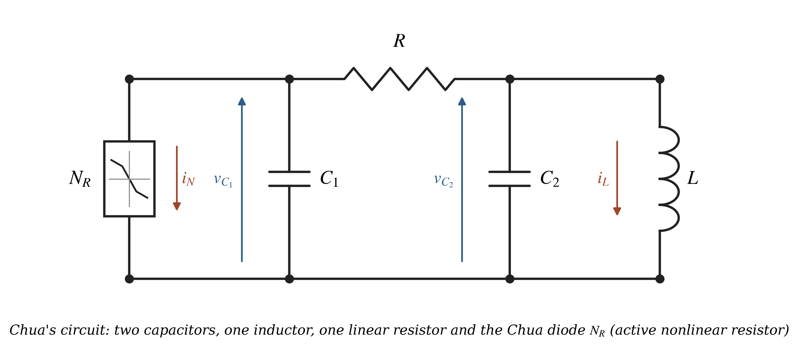
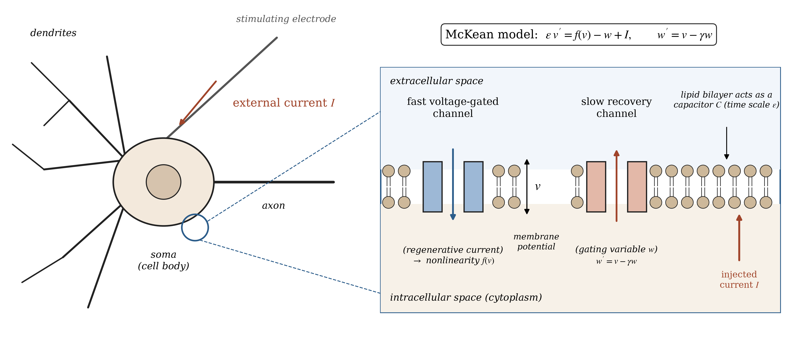

<script src="https://polyfill.io/v3/polyfill.min.js?features=es6"></script>
<script id="MathJax-script" async src="https://cdn.jsdelivr.net/npm/mathjax@3/es5/tex-mml-chtml.js"></script>

# 🔀 Bifurcations of Piecewise Linear Systems

### Foco–Centro–Limit-Cycle and saddle-node bifurcations in two engineering models: Chua's circuit and the McKean neuron


---

## 📌 About This Notebook

This notebook (`PWL_Bifurcations_Chua_McKean.ipynb`, MATLAB kernel) applies the results of Chapters 3, 5 and 6 of my Bachelor's Thesis on **continuous piecewise linear (PWL) systems** to two real engineering models. The goal is to turn the abstract theory into a *recipe*: given the physical parameters, the theorems say **where** the bifurcation happens and **which initial conditions** produce the periodic orbit.

| System | Zones | Bifurcation | Thesis results used |
|---|:---:|---|---|
| 🔹 **Chua-type circuit** (Chua diode + LC tank) | 2 | Foco–Centro–Limit-Cycle (FCLC) | Prop. 3.3, Theorem 5.1, eqs. (5.6), (5.10) |
| 🔹 **McKean neuron model** (FitzHugh–Nagumo caricature) | 3 | Saddle-node of periodic orbits | Prop. 3.5–3.6, Lemma 6.1, Theorem 6.2, eqs. (6.18)–(6.21) |

For each system the workflow is the same:

* 🔸 **Canonical form** (Liénard / normalised three-zone form)
* 🔸 **Initial values** predicted by the theorems
* 🔸 **Numerical simulation** with `ode45`, Poincaré maps and event detection
* 🔸 **Interpretation** of the plots in terms of the circuit / the neuron

<p align="center">
  
</p>
<p align="center">
  
</p>

---

## 🧮 Mathematical Highlights

**Two zones (Chua).** After $x=x_1,\; y=a_{22}x_1-a_{12}x_2-b_1$ the system becomes the Liénard form

$$\begin{pmatrix}x'\\y'\end{pmatrix}=\begin{pmatrix}T_{L,R}&-1\\D_{L,R}&0\end{pmatrix}\begin{pmatrix}x\\y\end{pmatrix}-\begin{pmatrix}0\\a\end{pmatrix}.$$

When $T_L>0$ is small, Theorem 5.1 gives a **stable limit cycle** crossing $\{x=0\}$ at $(0,y_0^*)$ with

$$y_0^*(T_L)=\Big(\tfrac{3\pi}{2}\Big)^{1/3}\big(a^{-3}D_L^{3/2}T_R\big)^{-1/3}T_L^{1/3}+\mathcal O(T_L^{2/3}).$$

**Three zones (McKean).** After the normalisation of Propositions 3.5–3.6 the system depends on $(t_L,d_L,t_R,d_R)$ and on two parameters $(m,a_C)$. Theorem 6.2 gives the bifurcation curve

$$a_C^*(m)=\Big(\tfrac{3\pi}{16}\Big)^{2/3}\Big(\tfrac1{t_R^2}-\tfrac1{t_L^2}\Big)^{1/3}m^{2/3}+\mathcal O(m),$$

separating **two limit cycles**, **one semi-stable cycle** and **none**, according to the sign of $t_Lt_R(t_L^2-t_R^2)\,(a_C-a_C^*(m))$.

---

## 🔬 Experiments & Results

### 🔌 Chua-type oscillator (two zones)

| Quantity | Theory | Numerics |
|---|---|---|
| 🔹 Crossing ordinate $y_0$ at $T_L=10^{-3}$ | 0.1956 (eq. 5.10) | 0.1987 (error 1.6 %) |
| 🔹 Period | 6.31487 (Thm 5.1) | 6.31487 (6 digits) |
| 🔹 Floquet multiplier | $e^{T_L\tau_L+T_R\tau_R}=0.7912$ | 0.7912 (finite differences) |
| 🔹 Scaling $y_0\sim T_L^{s}$ | $s=1/3$ | $s=0.330$ |

* 🔸 The oscillation appears with a **finite amplitude (≈ 2 V)** as soon as $T_L>0$: the cycle is attracted from both sides (stable).
* 🔸 The frequency is set by the LC tank (≈ 3.6 kHz for $L=18$ mH, $C=110$ nF).

### 🧠 McKean neuron (three zones)

| $m$ | $a_C^*$ numerical | $a_C^*$ eq. (6.19) | Relative error |
|---|---|---|---|
| 🔹 $10^{-4}$ | 0.002106 | 0.002099 | 0.3 % |
| 🔹 $10^{-3}$ | 0.009876 | 0.009746 | 1.3 % |
| 🔹 $10^{-2}$ | 0.047793 | 0.045317 | 5.2 % |

* 🔸 The error of the leading-order formula **decreases as $m\to0$**, confirming Theorem 6.2.
* 🔸 **Biophysical reading:** for a fixed current the neuron is **bistable** — a sub-threshold perturbation returns to rest, a supra-threshold one triggers sustained firing. The unstable cycle is the firing threshold.

---

## ⚖️ Strengths & Limitations

| ✅ Strengths | ⚠️ Limitations |
|---|---|
| Explicit formulas give the bifurcation point and initial conditions without blind search | Formulas (5.10), (6.19), (6.20) are **asymptotic** ($T_L\to0^+$, $m\to0^+$) |
| All thesis results are checked numerically (periods, multipliers, stability) | Chua's circuit is 3D; the notebook uses the **planar reduction** ($R\to0$, one-breakpoint diode) |
| Only core MATLAB, no toolboxes | The standard McKean model has $t_L=t_R$, so an **asymmetric version** ($s_R=+1$) is needed to satisfy $t_Lt_R<0$ |

> 💡 While verifying the formulas I found that $a_C=(d_C)_2/D_C$ (Proposition 3.6 writes $(0,1)\cdot d_C$, which is equal only when $D_C=1$) and that the proofs need $t_L+t_R\neq0$.

---

## 🛠️ Tech Stack


---

## ▶️ How to Run

```bash
pip install jupyter jupyter-matlab-proxy
jupyter notebook PWL_Bifurcations_Chua_McKean.ipynb
```

Select the **MATLAB Kernel** and *Restart & Run All* (a few minutes). Each numerical cell is self-contained because the kernel only keeps local functions inside the cell that defines them.

---
