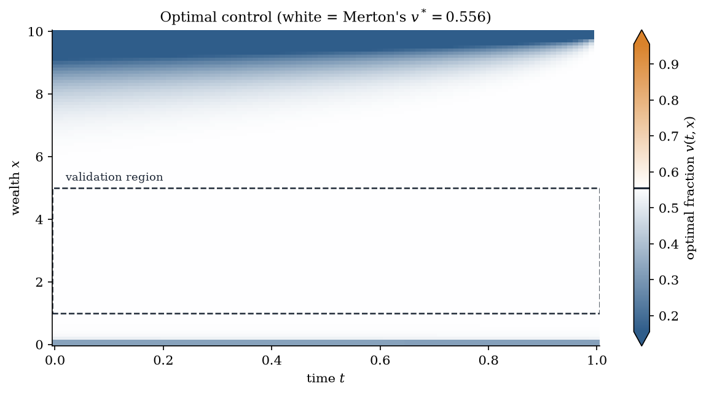

<div align="center">

# 📈 Stochastic Optimal Control
### Merton's optimal portfolio problem solved numerically with the HJB equation and Howard's policy iteration

<br>


<br>



</div>

---

## 📌 About This Notebook

This notebook (`portfolio_hjb.ipynb`) solves the classical **Merton portfolio problem**: an investor splits wealth between a risky asset (geometric Brownian motion) and a safe asset (deterministic growth) and chooses, at every instant, the fraction held in the risky one to maximize the expected utility of terminal wealth. It reads top to bottom as *problem → idea → code → results*, with the heavy theory moved to an appendix. It is organized as follows:

| Step | Section | Description |
|:-:|:---|:---|
| 🔹 | **The problem and the model** | Intuition first, then the wealth **SDE**, the value function and the **Hamilton-Jacobi-Bellman (HJB)** equation, with a notation table. |
| 🔹 | **Analytical benchmark** | For CRRA utility the optimal fraction is known in closed form (**Merton's formula**), which gives an exact reference for validation. |
| 🔹 | **Numerical strategy** | **Backward Euler** in time, **upwind finite differences** in space, and **Howard's policy iteration** (Newton's method on the HJB operator) for the nonlinearity. |
| 🔹 | **Implementation** | Six small functions (`build_mesh`, `compute_control`, `upwind_coefficients`, `assemble_system`, `solve_time_step`, `solve_hjb`), each followed by an `assert` test. |
| 🔹 | **Experiments and validation** | Control heatmap, slices, numerical vs analytical comparison, Howard convergence, and a mesh-refinement study. |
| 🔹 | **Appendix A: theory** | Newton-Kantorovich in Banach spaces, Danskin's theorem, and the finite-difference derivation. |

---

## 🧮 Mathematical Highlights

**💡 The HJB equation.** With wealth $dX_t = X_t\bigl(a u + b(1-u)\bigr)dt + \alpha u X_t\,dB_t$ and control $u\in[0,1]$, the value function $\Phi(t,x)=\sup_u \mathbb{E}[N(X_T)\mid X_t=x]$ solves

$$\Phi_t + \sup_{v\in[0,1]} \mathcal{L}^v\Phi = 0, \qquad \Phi(T,x)=N(x), \qquad \mathcal{L}^v f = x\bigl(b+(a-b)v\bigr)f_x + \tfrac12\alpha^2 v^2x^2 f_{xx}.$$

**📐 Merton's closed-form benchmark.** For CRRA utility $N(x)=x^\gamma/\gamma$ the ratio $\Phi_x/(x\Phi_{xx})$ equals $-1/(1-\gamma)$ everywhere, so the optimal control is constant:

$$v^* = \frac{a-b}{\alpha^2(1-\gamma)}$$

**🔁 Newton = Howard.** By Danskin's theorem, the derivative of the max operator is $\mathcal{L}^{v^*}$. A Newton step on the HJB equation is therefore *freeze the policy, solve one tridiagonal linear system, improve the policy*, which is exactly **Howard's policy iteration**. The assembled matrix is an **M-matrix**, so every step has a unique solution and the scheme is monotone.

---

## 🔬 Experiments & Results

Parameters: $a=0.06,\ b=0.03,\ \alpha=0.3,\ \gamma=0.4$, which give $v^*=5/9\approx0.556$, strictly inside $(0,1)$.

### 🎯 Validation against Merton
On a $100\times100$ mesh the numerical control reproduces Merton's constant fraction in the interior of the domain, with a maximum error of about **1.7·10⁻³**, and the value function has a relative error of about **5·10⁻⁴**.

### ⚡ Howard's iteration
Only **3–4 Howard iterations per time step** are needed (7 at the first step). Looking inside a single step, the residual of the discrete HJB system falls by several orders of magnitude per iteration down to rounding level, as expected for Newton's method.

### 📉 Mesh refinement
Refining space and time together ($N_x=N_t=25,\dots,400$), the error decreases monotonically, with an observed order of about **1.5** for the control and about **0.9** for the value function. A full solve takes well under a second, and the whole notebook runs in roughly 15 seconds.

---

## ⚖️ Strengths & Limitations

| ✅ Strengths | ⚠️ Limitations |
|:---|:---|
| **Exact benchmark** (Merton) available for validation | **Artificial boundary** at $X_{\max}$: the condition $\Phi_{N_x}=\Phi_{N_x-1}$ creates a boundary layer that propagates inwards, so validation is done in the interior |
| **Monotone scheme**: upwind + implicit time stepping give an M-matrix | **Upwind numerical diffusion** of order $O(\Delta x)$ |
| **Fast convergence**: a handful of Howard iterations, each an $O(N_x)$ tridiagonal solve | **Singularity at $x=0$**: $\Phi_x\sim x^{\gamma-1}$ is unbounded, so the first cells are inaccurate |
| Extends naturally to non-closed-form problems | Assumes $b\ge0$ so the upwind direction is fixed |

---

## 🛠️ Tech Stack

<div align="center">


</div>

**Main libraries:** `numpy` · `scipy.linalg` (`solve_banded`) · `matplotlib`

**How to run:**

```bash
pip install numpy scipy matplotlib
jupyter notebook portfolio_hjb.ipynb
```

All figures are saved in [`figures/`](./figures); the last code cell, `reproduce_all()`, regenerates them and prints the validation table.

---

## 📚 References

- R. C. Merton, *Lifetime portfolio selection under uncertainty: the continuous-time case*, Review of Economics and Statistics, 1969.
- R. C. Merton, *Optimum consumption and portfolio rules in a continuous-time model*, Journal of Economic Theory, 1971.
- H. Pham, *Continuous-time Stochastic Control and Optimization with Financial Applications*, Springer, 2009.
- Y. Achdou and I. Capuzzo-Dolcetta, *Mean field games: numerical methods*, SIAM Journal on Numerical Analysis, 2010.
